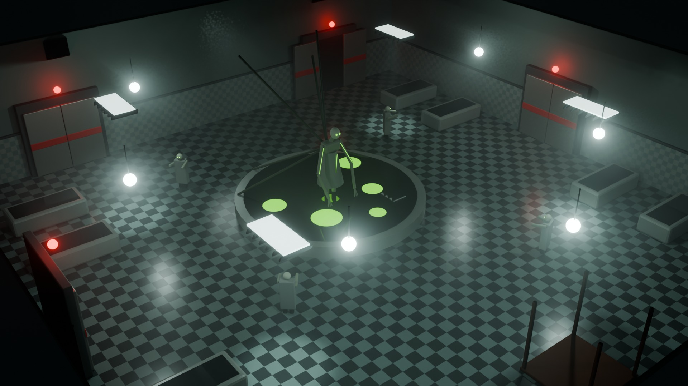
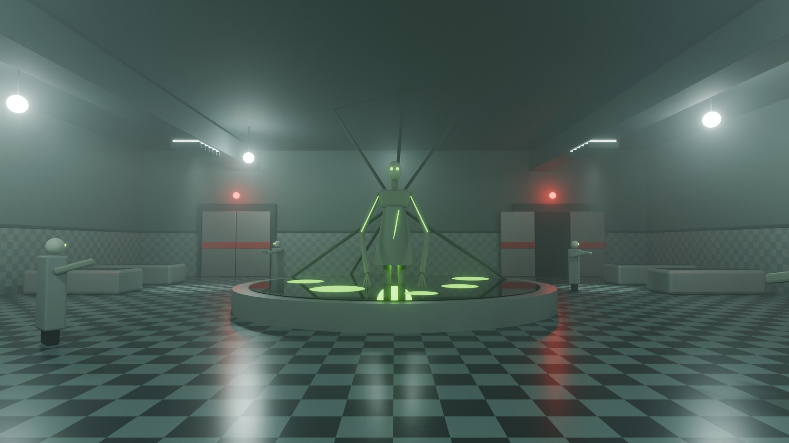
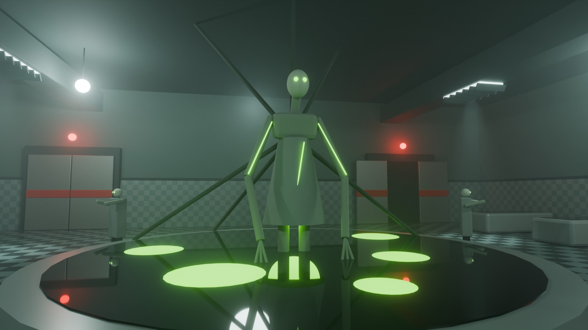

# Grauwald cold baths under Ward Zero: the Sleeper

Act I, chapter 4 (act boss). Concept only. Blockout source: `tools/concepts/grauwald_cold_baths.py`.

| From the descent point | The boss |
|---|---|
|  |  |

- **Mood:** a 1950s hospital basement kept as a tomb. Mist over checkered tiles, red lamps over shut doors.
- **Main landmark:** the round plunge pool in the centre: Fenlight mats on black water, the Sleeper standing in it.
- **Palette:** Fluorescent `#CDEEE8` globe lamps on tile and wall paint `#5F6D68`. Alarm red `#C3201B` on the fire doors, this zone's accent. Bio-green `#8DFF3A` only in the pool and the Sleeper's veins. No sodium: it is deep inside.
- **The Lit wear:** patient gowns.
- **Arena:** 26 x 26 m, 6.5 m high, eight side tubs as low cover. Descent: patient lift, south wall.
- **Cold tools:** four louvred cold-air vents in the ceiling ducts and four steel fire doors. Open vents to freeze the hall; shut doors to keep warm air and more Lit out (how they work is a proposal).
- **Boss silhouette:** 3.9 m. Thin and far too tall: arms to its shins, long neck, gown, roots from its back to the pool rim and ceiling. The opposite of the three heavy bosses before it.
