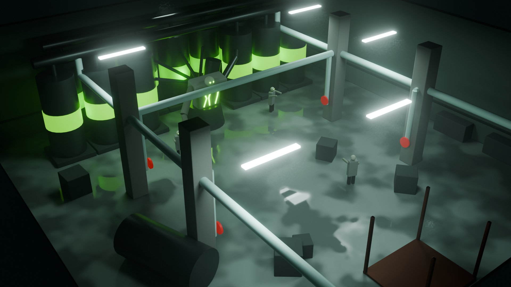
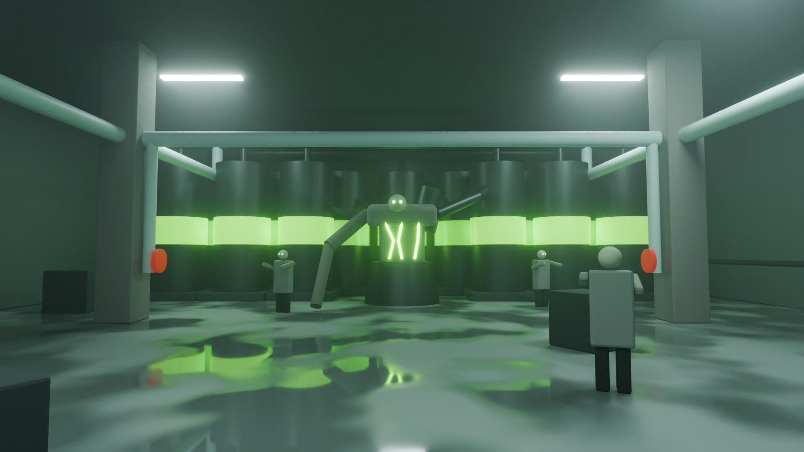
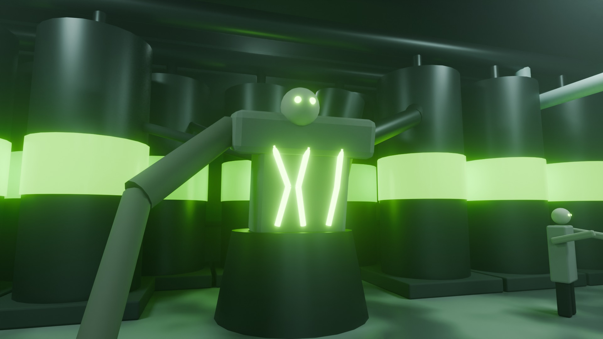

# Halcyon Labs Sublevel: the Night Supervisor

Act I, chapter 1. Concept only. Blockout source: `tools/concepts/halcyon_sublevel.py`.

| From the descent point | The boss |
|---|---|
|  |  |

- **Mood:** the last room that stayed cold. Quiet, humming, half the tubes dead.
- **Main landmark:** the cold tank array on the north wall: thirteen 5 m tanks under one manifold, the boss in the gap.
- **Palette:** Fluorescent `#CDEEE8` light on wall paint `#5F6D68` and wet floor. Bio-green `#8DFF3A` only in the tank windows and the boss's seams. No sodium: nothing here is outside.
- **The Lit wear:** lab coats (the night shift).
- **Arena:** 24 x 24 m, 7 m high, four pillars and crates as cover. Descent: freight elevator on the south wall.
- **Cold tools:** two frosted coolant mains with four red burst valves, one per pillar. Shoot a valve to freeze him, then shoot the glowing seams.
- **Boss silhouette:** 4 m, fused in place. A wide hunched torso in a split tank, one long arm to the floor, the other all pipe running into the array, a tank on his back. The head is the lightest value.
