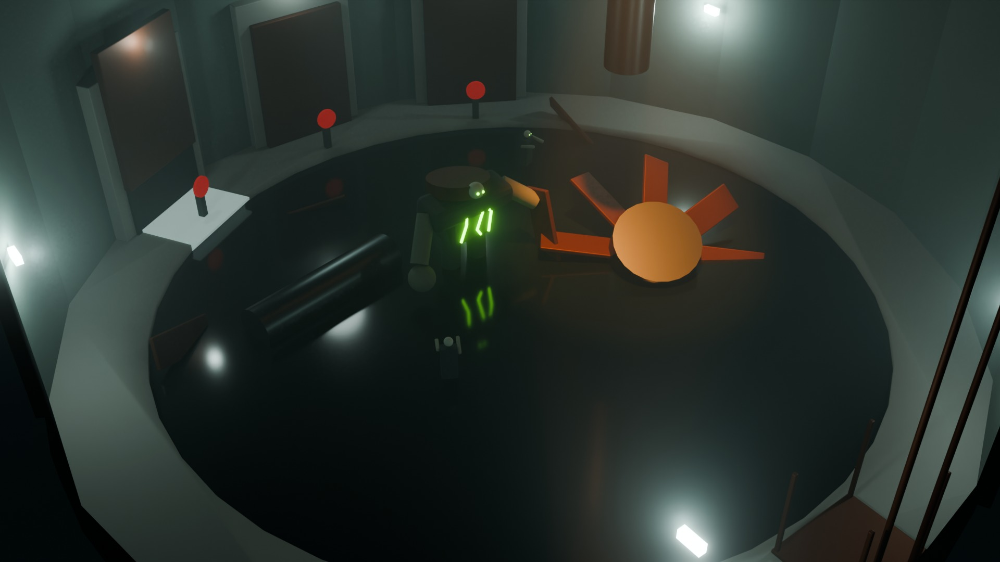
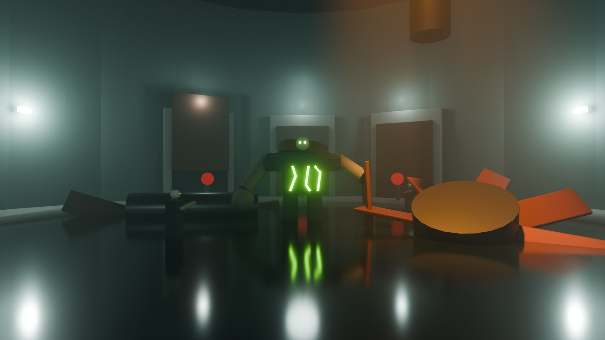

# Kessel Dam turbine pit: the Turbine Keeper

Act I, chapter 2. Concept only. Blockout source: `tools/concepts/kessel_turbine_pit.py`.

| From the descent point | The boss |
|---|---|
|  |  |

- **Mood:** the bottom of the dam on the coldest night. Black water, echo, one warm shaft of light from the world above.
- **Main landmark:** the turbine runner torn off its shaft, lying in the basin under the broken stub, lit by the sodium shaft.
- **Palette:** Fluorescent `#CDEEE8` wall lamps on wall paint and concrete. Sodium `#FF9A42` only in the shaft from the dam top (outside). Bio-green `#8DFF3A` only on the boss's seams and eyes. Alarm red `#C3201B` on the gate wheels.
- **The Lit wear:** dam overalls.
- **Arena:** round pit 28 m across: a 2.9 m ring walkway around a basin 0.6 m lower. Descent: service lift down the turbine shaft, south side.
- **Cold tools:** three floodgates on the north wall, each with a red wheel. Open one and reservoir water floods the basin and slows him. Loose turbine blades are the debris to dodge.
- **Boss silhouette:** 3.8 m. Huge square shoulders, a stator ring behind the neck, one fist, one arm ending in a turbine blade. A small pale head hung forward.
