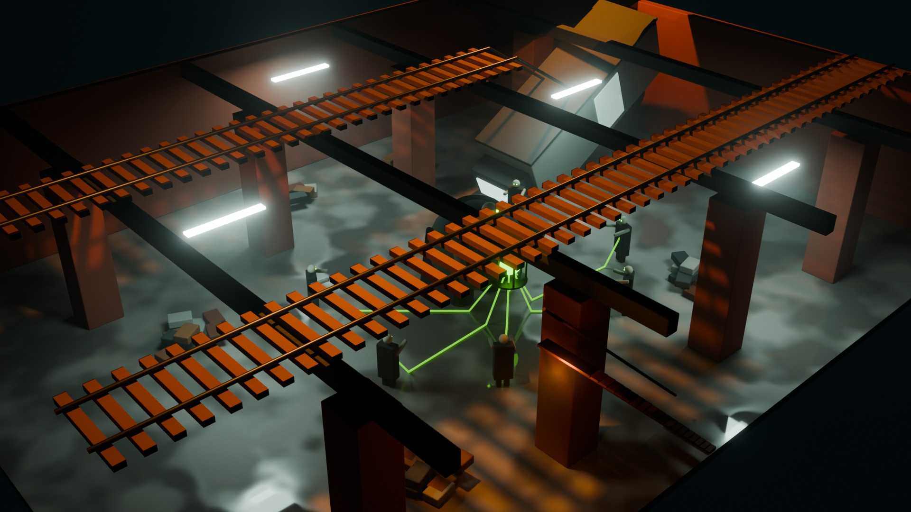
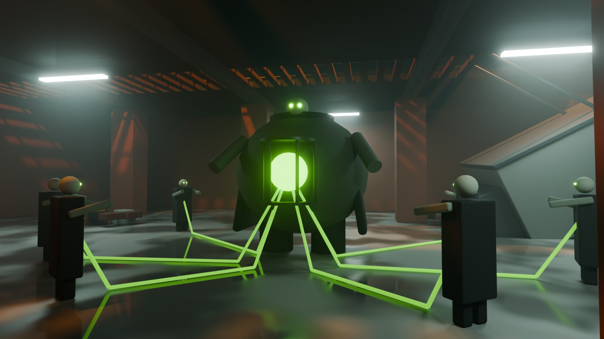
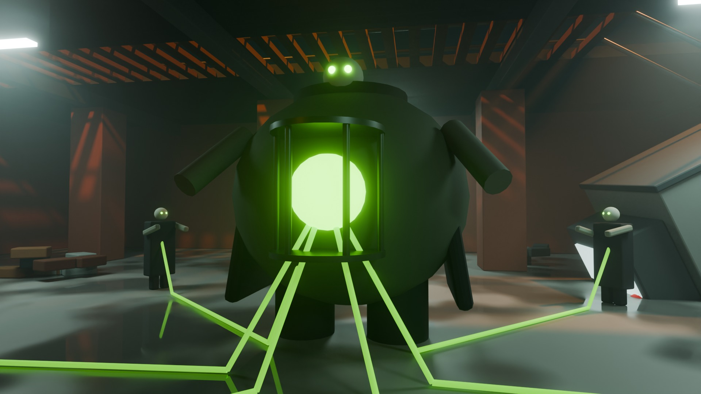

# Under the Marrow Junction yard: the Courier

Act I, chapter 3. Concept only. Blockout source: `tools/concepts/marrow_underyard.py`.

| From the descent point | The boss |
|---|---|
|  |  |

- **Mood:** the most human map, seen from underneath. Suitcases in the dark, sodium light falling through the sleepers in stripes.
- **Main landmark:** a refrigerated wagon that fell through the caved-in track and lies tilted in the east end.
- **Palette:** Fluorescent `#CDEEE8` work lamps on brick and wet concrete. Sodium `#FF9A42` only from the yard above: between the sleepers, through the hole and down the stair hatch. Bio-green `#8DFF3A` only on the Siphon core, its cords and Lit eyes.
- **The Lit wear:** long travel coats (evacuees).
- **Arena:** 30 x 22 m, 5.7 m high, eight brick piers. Descent: iron stair from a yard hatch, south wall.
- **Cold tools:** the wagon's cooling unit; shoot its red valve to vent cold across the floor (a proposal: the lore names no cold tool here yet). Six feeder hosts are tied to the Siphon by cords. Kill them first.
- **Boss silhouette:** 3.6 m. A swollen ball of a body around the caged Siphon, stub legs, torn coat flaps, a tiny pale head.
