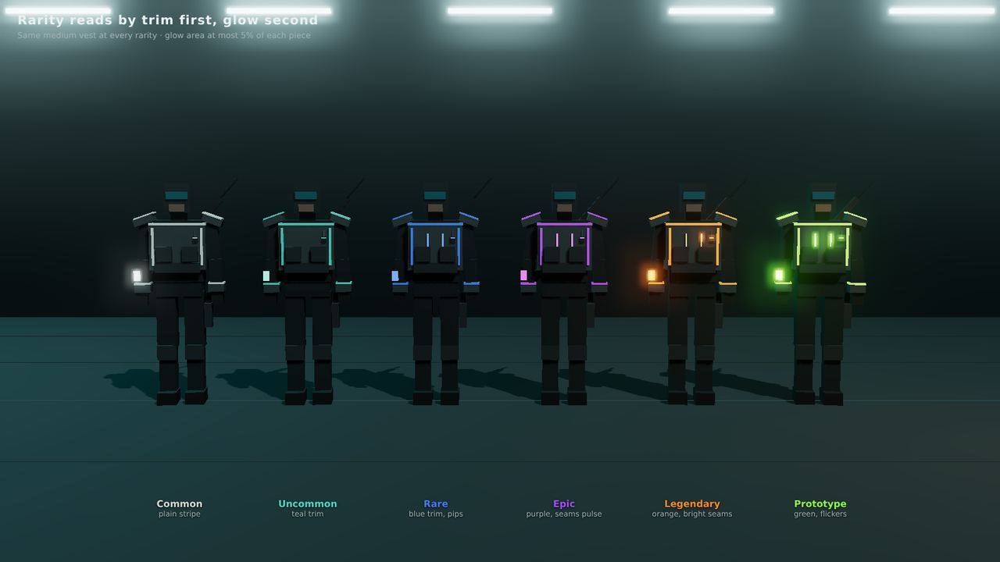
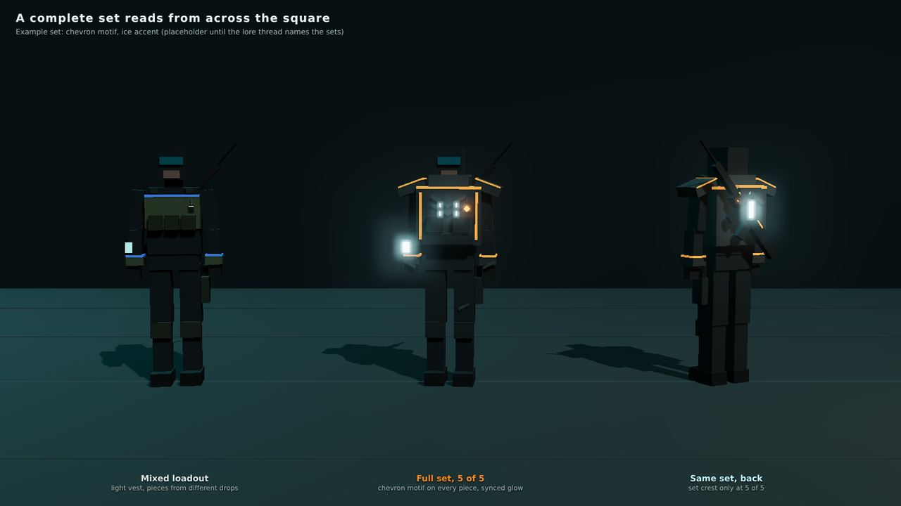
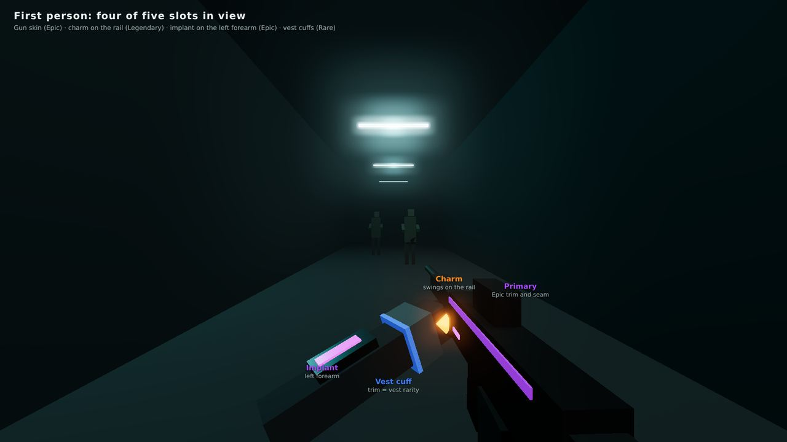

# Visible Gear on Characters

Source: copy of the design doc as of Nov 14, 2026. Where this file and the code differ, the code and `docs/DECISIONS.md` win.

## Summary

Every one of the 5 gear slots gets a fixed spot on the body, and 4 of those spots are in view in first person. That solves the core problem: you see your own loot while you play, not only in menus.

| Slot | Where it shows on the body | Seen in first person? |
| --- | --- | --- |
| Primary | In hands, slung on the back when holstered | Yes, always (gun skin) |
| Sidearm | Thigh holster, in hands when drawn | Yes, when drawn |
| Vest | Torso shell, shoulder pads, and the sleeve cuffs on your forearms | Yes, sleeves and cuffs |
| Charm | Hangs from the primary's rail, clips to the vest when the gun is away | Yes, swings on the gun |
| Implant | Module on the left forearm, glowing port at the neck | Yes, left forearm on the handguard |

The rest of the design in short:

- **One body, one skeleton, one gear shader.** Only the vest bends with the body. Everything else is a rigid piece stuck to a bone. That keeps the Blender scripts small and the rig simple.
- **Rarity is shown by trim, not by glow everywhere.** Each piece has a dye area, a trim area and a small glow area, painted as vertex colours. Rarity sets the trim colour and how much glows. Glow never covers more than 5% of a piece, so zombies and enemy tells stay readable.
- **Sets share a shape motif.** A full 5 of 5 set adds a back crest and makes all its lights pulse in sync.
- **Legendaries get one signature effect each**, picked from a library of 6 effects.
- **Dyes: yes, 2 channels.** Trim always stays the rarity colour.
- **Transmog:** no (decided). You always look like what you wear; dyes are the only way to style gear.
- **Appearance is a tiny message (about 40 bytes per player)** sent by the server when gear changes, never every frame.
- **Same rig everywhere:** town third person, co-op teammates, character screen, inspect, end-of-run lineup.

Provisional picks are marked *(provisional)*. They follow the project rule: reversible calls are made now and can change after a play test.

## Where gear is seen

There are six places a player looks at gear. All six use the same `GearRig` node and the same look data, so a piece built once shows up everywhere.

| View | Camera | What the player sees | Notes |
| --- | --- | --- | --- |
| First person, in a run | Your eyes | Gun skin, charm swinging on the rail, implant on the left forearm, vest sleeves and cuffs, sidearm when drawn | Separate first-person arms mesh. Your full body only casts a shadow. |
| Co-op teammates | Your eyes | Their whole character at 2 to 40 m | The main way gear is shown off. Silhouette and trim colour must read at 30 m in fog. |
| Town (Lantern Post) | Third person over the shoulder | Your whole character and up to 7 others | Town is where people show off, so the camera is close and the light is warm and flat. |
| Weapon inspect | First person, gun raised and turned | Gun skin, charm, Legendary effect up close | Hold the inspect key. Works in runs and in town. |
| Character screen | Turntable in a lit booth | Whole character, drag to spin, scroll to zoom | Hovering a slot zooms to that body spot. Shows a dye preview before you pay. |
| End of run | Squad lineup, slow pan | All squad members side by side, top scorer in front | A short beat (about 4 s) before the stats panel. |

One extra view comes for free: **inspect another player in town**. Look at them and press the interact key to open their character screen turntable with their gear list. *(provisional)*

**Readability rule for co-op:** a teammate's rarity has to be clear from the trim colour alone at 30 m. Glow helps up close but is not needed to read it. Zombies never use the rarity colours on their bodies, so a glowing orange seam always means a player.

## Character rig and gear per slot

One skeleton, one base body in an undersuit, and gear pieces snapped on top. Only the vest is skinned (bends with the body). Every other piece is a rigid mesh on a `BoneAttachment3D`, which is the simplest thing Godot offers and needs no weight painting.

**Skeleton:** 22 bones, built in the Blender script, same bone names in every file. Pelvis, spine 1 to 3, neck, head, and per side clavicle, upper arm, forearm, hand, thigh, shin, foot. That is 20; two socket bones for gear make 22: `sock_thigh_R` (holster) and `sock_back` (slung primary). *(provisional)*

**Base body:** one body shape, an undersuit with a balaclava and goggles. Skin tone, undersuit colour and goggle tint are shader values, not separate meshes. A second body build or face options can come later without touching gear, because gear only cares about bone names.

**First-person arms:** a separate mesh of just the forearms and hands, drawn on its own render layer with a tighter field of view. It carries the same three sockets the world body does on the forearms: sleeve cuff (from the vest) and implant module (left forearm).

| Slot | Mesh parts | Attaches to | Skinned? | Shape variants |
| --- | --- | --- | --- | --- |
| Primary | Gun body + attachments (already code-built in `build_models.py`) | Right hand, `sock_back` when away | No | One per gun type, skin by shader |
| Sidearm | Pistol + holster | Right hand, `sock_thigh_R` when away | No | One per pistol type |
| Vest | Torso shell, 2 shoulder pads, sleeve cuff pair, first-person cuff pair | Spine 2, spine 3, clavicles, forearms | Shell yes, pads and cuffs no | Light, medium, heavy frame |
| Charm | Small hanging trinket with a 2-link chain | Gun rail socket, vest chest clip when gun is away | No (the chain swings by a tiny spring script) | One per charm type |
| Implant | Forearm module + neck port | Left forearm, neck | No | One per implant type |

**Why the vest owns the sleeves:** it is the only wearable armour slot, and the cuffs are what you see of it in first person. One vest item therefore changes the torso, the shoulders and both forearms. That makes swapping a vest feel big, which matches it being the main armour drop.

**Base mesh per item type, not per item.** A Rare and a Common of the same vest use the same mesh. Rarity, dye and Legendary effect are shader values on top. Only set pieces and named Legendaries get their own mesh. That keeps the mesh count small: about 3 vest frames, 5 charms, 5 implants and the gun list at first, plus 5 pieces per set and one per named Legendary.

## Rarity and set visual language

Rarity climbs in three steps you can read in order: trim colour first (readable at 30 m), then material quality (readable at 10 m), then glow and motion (up close). Colours are the rarity hex codes from the style guide.

**Three paint zones per piece.** Every gear mesh has its faces painted with a vertex colour in the Blender script: red = dye area, green = trim area, blue = glow area. One shader reads these. No textures are needed in stage A, which suits AI-built assets.

| Rarity | Trim colour | Material | Glow area | Motion |
| --- | --- | --- | --- | --- |
| Common | #D9D9D2, plain stencil stripe | Matte painted metal, worn fabric | None | None |
| Uncommon | #3FE0C8 teal | Same, cleaner edges | None | None |
| Rare | #3D7DFF blue | Satin metal, slight sheen | Small pips, low (0.6) | None |
| Epic | #A64DFF purple | Satin metal, darker base | Seams, medium (1.2) | Slow breathing pulse, 4 s |
| Legendary | #FF8A1C orange | Brushed metal, deep base | Seams, bright (2.0) | Pulse plus the item's signature effect |
| Prototype | #8DFF3A bio-green | Same mesh as the item, wet sheen | Seams, bright (2.0) | Uneven flicker, like it is unstable |

The glow area is at most 5% of a piece's surface. Brightness values are emission strength in the shader and will be tuned in a play test. *(provisional)*

**Set visual language.** Each set has one shape motif that repeats on all 5 pieces, so a mixed loadout with 2 set pieces still looks related. Examples of motifs: a ribbed collar shape, a chevron plate, a hex cut-out, a hanging tag strip, a cable wrap. Each set also has a fixed accent colour for its glow area, chosen to stay away from the rarity colours (set pieces are Legendary rarity, so their trim is orange and their glow carries the set accent). The motif and accent belong to the set's lore (which map it comes from); the lore thread can name them.

**Silhouettes by vest frame.** Light, medium and heavy vests change the outline of the torso and shoulders. That is what teammates read first at distance, before colour. Heavy frames add a tall collar and bigger pads, light frames are flat chest rigs.

## Full sets, Legendaries and dyes

### How a complete set looks

Set bonuses come at 2, 3 and 5 pieces. The look follows the same steps, so players can tell from across the town square how far someone is.

| Pieces worn | Extra look |
| --- | --- |
| 1 | The piece itself, with the set motif and accent |
| 2 or 3 | Nothing extra; the shared motif already ties them together |
| 5 of 5 | **Set crest** on the back (a small set-specific piece on `sock_back`, moved aside when a primary is slung) and all set glow areas **pulse in sync** |

The crest is the one reward for completing a set, so it should feel earned but stay small: under 600 triangles and no particles. In first person a 5 of 5 set shows as the synced pulse on the cuffs, implant and charm.

### Legendary signature effects

Each named Legendary picks one effect from a small library, plus a colour. New Legendaries add data, not code.

| Effect | What it does | First person |
| --- | --- | --- |
| Seam flow | Light travels along the glow seams | Yes |
| Heat haze | Faint shimmer above the piece | Off (blocks aim) |
| Motes | 3 to 6 slow sparks orbit the piece | Off |
| Frost rime | Pale crystal edge layer, melts while firing | Yes |
| Tick | Glow area flashes on each kill | Yes |
| Trail | Short ribbon trail when the piece moves fast | Off |

Effects run only within 20 m of the camera and at most 8 effects are live at once (the nearest win). The effect plays on the item's mesh wherever it is shown, so a Legendary charm shows its effect on the gun in first person. *(provisional)*

### Dyes (recommended: yes, my pick)

Two dye channels per piece: main and accent. Both paint the dye area of the mesh; trim and glow are never dyed, so rarity always reads. Dyes are found as consumable drops and crafted at the Workbench; once used, a dye is unlocked for good on your character and can be applied to any piece for a small Scrap cost. Start with 16 dyes in the Cold Containment palette (concrete greys, teal, olive, sodium tan, hazard yellow). Dye is stored on the item, so it stays when you stash it. *(provisional)*

### Transmog: no (decided 2026-11-14)

Players always look like the gear they wear. That keeps every look honest at a glance and saves the wardrobe system. Dyes are the only styling. If this changes later, it needs one extra field on the item's look and a list in the save, so it is not locked out.

## Concept previews

Three blockout renders in the Cold Containment style, built from boxes the same way the Blender scripts will build gear. They show layout and colour logic, not final art.

**1. Rarity lineup.** The same medium vest at all six rarities. Trim colour carries rarity on its own; glow only joins from Rare up.



**2. Mixed loadout vs a full set.** The set uses a placeholder chevron motif and ice accent. Front and back views; the crest only appears at 5 of 5.



**3. First person.** Gun skin, charm on the rail, implant on the left forearm and the vest cuff are all in view while aiming down the corridor.



## Build pipeline, LOD and performance

### How AI code builds it

The existing `tools/assets/build_models.py` already builds the rifle and wall panel from boxes in Blender Python and exports `.glb`. Gear follows the same pattern, split so no file grows large:

| File | Builds |
| --- | --- |
| `tools/assets/character/rig.py` | Skeleton (22 bones), base body, first-person arms |
| `tools/assets/character/paint.py` | Helpers: paint dye, trim and glow zones as vertex colours; bind to bones |
| `tools/assets/gear/vests.py` | Light, medium, heavy vest frames |
| `tools/assets/gear/charms.py`, `implants.py` | One small function per piece |
| `tools/assets/gear/sets/<set_id>.py` | The 5 pieces and crest of one set |
| `tools/assets/gear/legendaries.py` | One function per named Legendary mesh |

Each piece is a short function made from boxes, bevels and cylinders, then `paint.zone(...)` marks its dye, trim and glow faces. The script checks every piece before export: triangle budget, bone names exist, all three zones painted, glow area at most 5%. A failed check stops the build, so CI catches a broken piece.

In Godot, one shader `gear.gdshader` reads the vertex colours. Dye, rarity trim, glow strength and pulse are **per-instance shader parameters**, so every piece of gear shares one material. Legendary effects are small scenes in `content/gear_fx/` attached next to the mesh.

### Budgets with 8 players

| Part | Triangles at LOD0 | Notes |
| --- | --- | --- |
| Base body | 6,000 | Skinned |
| Vest (shell, pads, cuffs) | 3,000 | Shell skinned |
| Primary gun | 4,000 | Rigid |
| Sidearm + holster | 1,500 | Rigid |
| Charm | 300 | Rigid, spring script on the chain |
| Implant | 500 | Rigid |
| Set crest | 600 | Only at 5 of 5 |
| **One character** | **about 16,000** |  |

Eight characters is about 128,000 triangles and 16 skinned meshes (body + vest each). That is small for a 4080 Super at 1440p; the zombie horde and the level will cost far more. *(provisional, check in the 120 fps test)*

**Level of detail:** Godot builds mesh LODs on import automatically. On top of that, visibility ranges: charm and implant hide past 25 m, Legendary effects past 20 m, crest past 40 m. Particles are capped at 8 live effects. Teammates' guns skip the inspect detail mesh entirely.

**Draw calls:** about 7 per character (body, vest, 2 guns, charm, implant, crest), so 56 for a full squad. Because they share one material, Godot can group them well.

## Data model and network sync

### Resources

Looks are content, so they live as `.tres` files next to the other content. Adding a new piece = one Blender function + one `.tres`.

| Resource | Folder | Key fields |
| --- | --- | --- |
| `GearVisual` | `content/gear_visuals/` | `id`, `slot`, `scene` (the `.glb`), `fp_scene` (optional first-person version), `attach` (bone or socket name), `set_id` (empty if none) |
| `RarityLook` | `content/looks/rarity/` | `rarity`, `trim_color`, `glow_strength`, `pulse_seconds`, `flicker` |
| `SetLook` | `content/looks/sets/` | `set_id`, `accent_color`, `crest_scene` |
| `GearFx` | `content/gear_fx/` | `id`, `scene`, `show_in_first_person` |
| `Dye` | `content/dyes/` | `id`, `name`, `color` |

The item base resource (from the affix and item work) gets one new field: `visual_id`. A named Legendary also gets `fx_id` and `fx_color`. Nothing in the visuals ever reads affixes or stats.

### Item dict and save file

One optional key is added to the item dict. Missing means default, so old saves load as they are.

```
"look": {"dye": ["dye_concrete", "dye_teal"]}
```

The save file gets an `unlocked_dyes` list per character.

### Turning gear into a look

`LookBuilder.from_equipped(items) -> CharacterLook` is one pure function: for each slot it takes the item's visual id, the dyes, the **real** rarity, the Legendary effect and the set count. `GearRig.apply(look)` swaps the meshes. The character screen, inspect, town, teammates and end-of-run all call these two and nothing else.

### Network sync

The server owns inventories, so the server builds each player's `CharacterLook` and sends it. Clients never send their own look, so nobody can fake a Legendary.

- Sent once on join (all players' looks to the new player) and again only when someone's gear, dye or transmog changes. Never per frame.
- Reliable RPC, about 40 bytes per player: per slot a short visual index, 2 dye indexes, rarity and effect index; plus skin and undersuit values. Indexes come from a content table both sides build at start, checked by a content hash on join.
- Unknown id on a client (older build): show the base mesh for that slot in Common look, never crash.

## Build order, tests and open decisions

Build it in small PRs, each with its own tests (no tests, no merge):

1. **Rig and body.** `rig.py` builds the skeleton, body and first-person arms. Test: the export check (bone names, triangle budget) runs in CI.
2. **Gear shader and paint zones.** `gear.gdshader`, `paint.py`, the 6 `RarityLook` files, one medium vest. Test: every rarity file loads; shader parameters exist.
3. **GearRig and LookBuilder.** Swap meshes from a `CharacterLook`. Tests: `from_equipped` maps each slot to the right visual, rarity and set count; unknown id falls back to Common; every `GearVisual` file loads and its attach bone exists on the skeleton.
4. **First-person view.** Cuffs, implant and charm on the first-person arms and gun. Test: the first-person scene has the three sockets.
5. **Character screen turntable.** Booth light profile, slot hover zoom. Test: UI router opens it with a look and no errors.
6. **Network sync** (with the first co-op build). Tests: look encodes to 64 bytes or less and decodes to the same look; content hash mismatch is refused.
7. **Sets, crest and Legendary effects** (with the first set content). Tests: 5 of 5 shows the crest, 4 of 5 does not; effects respect the 8-effect cap.
8. **Dyes** (P9 with crafting). Tests: save round trip keeps `look` and `unlocked_dyes`; old saves without them load.

### Open decisions

- **Transmog:** decided no on 2026-11-14. Everything else here is provisional and reversible.
- **Set motifs and accent colours** are left for the lore and per-map set work, so they match each map's story.
- **A second body build or face options** are out of scope for now; the rig allows them later without touching gear.
