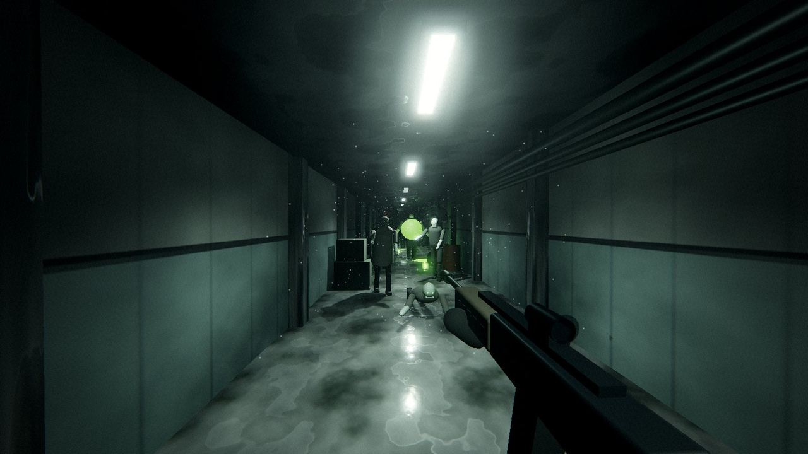
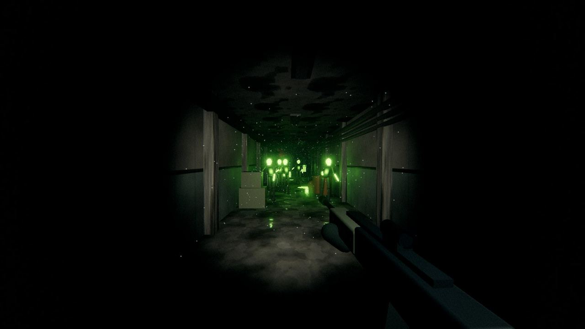
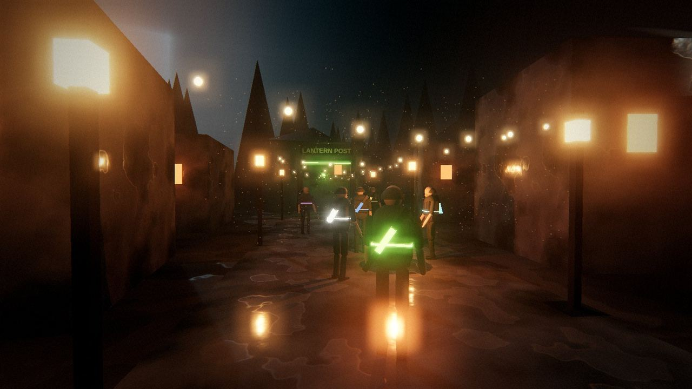
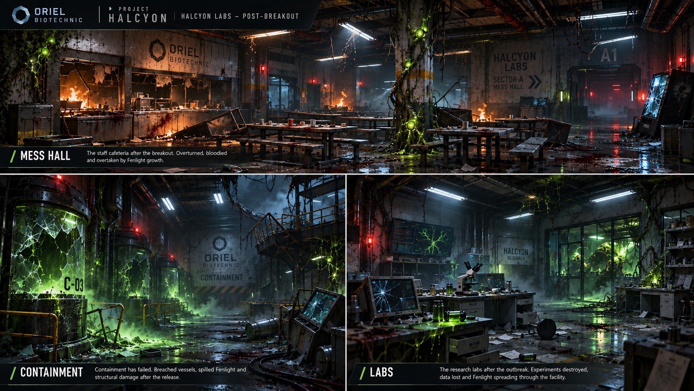
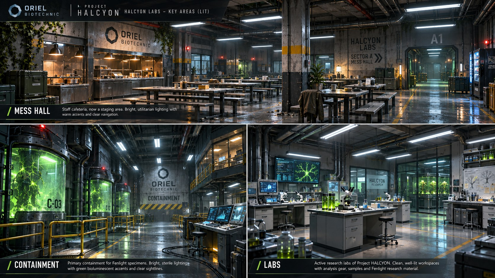
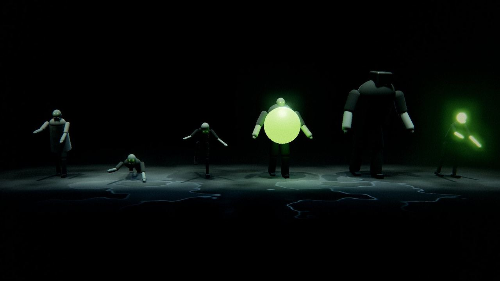
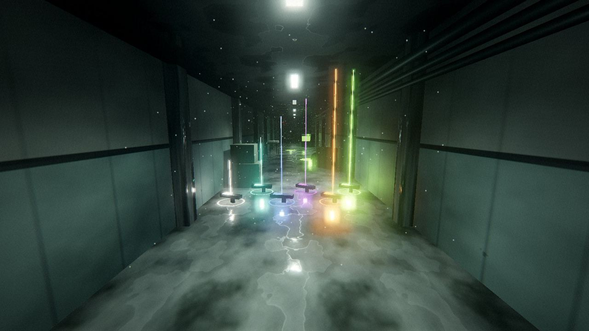

# Look rules: Cold Containment

The chosen art direction (14 Nov 2026). Read this before any art, lighting,
material, model, UI colour or VFX work. The game should look like the
style-guide renders below: stylised, code-built shapes, strong lighting,
wet concrete, cold teal inside, warm sodium outside, and bio-green only where
the experiment leaks.

If this file and `docs/DECISIONS.md` disagree, `DECISIONS.md` and the code win.

| Blackout round | Lantern Post (town) |
|---|---|
|  |  |

## Halcyon Labs target

| After the breakout (**the look target**) | Before the breakout (what the rooms were) |
|---|---|
|  |  |

Match the post-breakout image for signage, wreck, Fenlight growth and fire,
but keep the map as dark as it is: new light only comes from Fenlight, fire
and red lamps. Plan: [halcyon-concept-pass.md](../plans/halcyon-concept-pass.md).

## Palette

| Name | Hex | Use |
|---|---|---|
| Fluorescent | `#CDEEE8` | Interior light colour (cold teal-white) |
| Fog / background | `#0A1416` | Dark scene background, darkest value |
| Wall paint | `#5F6D68` | Painted concrete walls |
| Sodium | `#FF9A42` | Exterior lamps, loading dock, warm accents |
| Bio-green | `#8DFF3A` | The experiment only (see rules) |
| Blood / alarm | `#C3201B` | Alarm lights, round number, damage |
| Blood (gore) | `#5A0E0C` to `#5A0F0F` | Dark red-brown, never bright red |

Zombie skin and clothing (from `tools/assets/build_models.py`): head
`#B9C2B0` (always the lightest value), skin `#8E9887`, dark skin `#6C7566`,
lab coat `#8A918C`, shirt `#2F393B`, trousers `#1C2122`, shoes `#0E1010`,
Bloater skin `#4A5446`.

## Rules

1. **Readability beats realism.** Zombie heads are the lightest value in their
   silhouette. Pickups are visible from 30 m. Each enemy type has its own shape.
   If lighting breaks one of these, change the lighting.
2. **Bio-green is reserved** for the experiment: leaks, Glowers, Bloater
   bellies, zombie eyes, SpecimenVault, Reforger, power-ups, Prototype loot,
   the Deploy Gate. Never for UI chrome, foliage, decoration or XP.
3. **Two value bands.** Environment is dark to mid grey. Anything you use or
   shoot is one step brighter or rim-lit. Emission above 1.0 HDR only on
   gameplay objects and light fixtures.
4. **One accent light per zone** (red alarm wing, sodium dock, flickering
   offices) so players learn the map.
5. **Inside cold, outside warm.** Colour temperature tells you where you are.
6. Guns: matte black and gunmetal, polymer, one secondary colour (tan, olive
   or grey). Rarity shows only as a thin inlay strip and optic glass colour; no
   full-gun recolours. Original designs, no real brand marks. Small accents are
   fine: yellow mag tape, brass, and Oriel Biotechnic marks (our own company).
   The four wall guns are heavily worn, chipped and grimy, like the concept
   sheet [images/guns_concept.jpg](images/guns_concept.jpg).

## Godot settings (what the repo uses)

Shared interior environment: `levels/looks/halcyon_interior.tres`. Every
interior scene uses this file, never a copy.

| Setting | Value |
|---|---|
| Renderer | Forward+, TAA on, MSAA off |
| Tonemap | **AgX** (`tonemap_mode = 4`), exposure 1.05 |
| Background | colour `#0A1416` |
| Ambient | colour `#24363A`, energy **0.2** (baked bounce fills shadows) |
| Volumetric fog | density 0.03, albedo light teal-grey (0.6, 0.7, 0.7), anisotropy 0.45, length 48 m |
| Glow | levels 3 to 5, intensity 0.8, HDR threshold 1.0, blend Screen |
| Adjustments | contrast 1.08, saturation 0.82 |
| SSAO | on, radius 1.0, intensity 2.0 |
| SSR | on (wet floors), max steps 32, fade in 0.15 / out 2.0 |
| SDFGI / SSIL | off. Bounce light is baked with LightmapGI |
| Grain, vignette | `systems/effects/film_post.tscn` (grain 0.045, vignette 0.38) |

The style guide said ACES and ambient 0.35. The repo moved to AgX and 0.2 on
purpose; keep the repo values.

### Light rules

- LightmapGI bake: High, 3 bounces, denoiser. Godot has no command-line bake:
  re-bake in the editor on a GPU after any geometry or light change, commit the
  `.exr` and `.lmbake`.
- At most **6 shadowed real-time lights** in view (flashlight, muzzle flash,
  2 to 3 flickering fixtures, Vault beacon). Shadow atlas 4096, soft shadows Low.
- Light bake modes: 0 Disabled (cheat lights like `ZombieRim`, `ViewFill`),
  1 Static (bake only), 2 Dynamic (fixtures: real-time direct, baked bounce).
- One unshadowed `ZombieRim` spot per area shines back toward the player so
  zombie silhouettes read. A camera fill light keeps the viewmodel from going
  black.
- Muzzle flash light colour `#FFD9A0`, tracers `#FFE6B0` (Prototype guns
  `#8DFF3A`).
- Atmosphere effect lights (alarm beacons `#C3201B`, sparks, swinging lamp):
  no shadow, bake mode 0, distance fade 20 m. Nothing in the atmosphere casts
  shadows (moving casters make shadowed lights redraw every frame). Particles: GI off, visibility
  range 30 m, at most 400 per room and 1,500 per map. Spark gap 3 to 9 s,
  klaxon every 30 s, sound spots 14 m max. Story decals fade out between 25
  and 30 m.
  Dust specks 16 mm, alarm beacons energy 10 (amounts confirmed on a GPU
  screenshot check, 2026-11-17).

### Materials

Shared materials live in `levels/materials/` (concrete, wet floor, panel
paint and trim, wall paint, pipe, rust, brick, wood, fluorescent, emergency
tube, bio leak). Surface detail is world-space, so kit pieces need no UVs:
`grime.gdshader` (drips, floor dirt, ceiling stains, plus optional texture
sets) and `wet_tiles.gdshader` (tiles, grout, mirror puddles for SSR).
Texture sets (albedo, normal, ORM) are made by `tools/assets/surface_textures.py`
into `assets/textures/halcyon/`; the script is the source. Albedo maps are
near-grey detail tinted by the material's palette colour. Reuse these before
making new ones.

## Models built in code (`tools/assets/build_models.py`)

- Run `python tools/assets/build_models.py [name]` (Python 3.13, bpy from
  `tools/assets/requirements.txt`). The script is the source; never hand-edit
  the `.glb`. Commit the `.glb` and its `.import`.
- Units are metres. Blender +Y forward, +Z up; the exporter turns that into
  Godot -Z forward, +Y up. Guns point down Godot -Z.
- **Zombies face Blender -Y, which is Godot +Z**, feet at 0. Body parts are
  separate objects with their origin at the joint (`attach()` / `limb()`), so
  code can swing them.
- Colours: take hex from this file and convert with `srgb()` (linear values).
  Glow only through the `glow` argument, and only on bio-green parts.
- Gun parts code needs by name (like `Magazine`, `Muzzle`) get a check in
  `tests/content/test_generated_models.gd`.
- Import setting `meshes/light_baking`: kit pieces (walls, static props) = 2
  (Static Lightmaps, needs UV2); moving things (zombies, guns) = 3 (Dynamic).

## Zombies

Left to right: Shambler (lab coat), Crawler, Stalker, Bloater, Brute, Glower.

| Type | Silhouette | Colour and glow | Visible tell |
|---|---|---|---|
| Shambler | Upright, arms reaching, staff clothing | Grey-green skin, dull institutional clothes | Faint green eyes |
| Crawler | Flat to the ground, legs missing | Like Shambler, darker | Scrape trail decal |
| Stalker | Thin, long arms, crouched, walls and ceiling | Pale, almost white | Eyes flare before a pounce |
| Bloater | Round, wide, slow | Belly of green-glowing gas pods | Pods swell when hit |
| Brute | 1.5x player height, huge shoulders, metal head plate | Dark, rust-brown plate | Plate sparks and cracks |
| Glower | Thin, fast, hunched | Full-body green veins | Lights the room, Blackout only |

## HUD and UI colours

Fonts: Atkinson Hyperlegible Next (text), Atkinson Hyperlegible Mono (numbers).
Full UI tokens and every screen: [ui-hud.md](ui-hud.md).

| Name | Hex | Use |
|---|---|---|
| Text | `#E8ECE6` | HUD text, crosshair, body hitmarker |
| Round red | `#C3201B` | Round number, damage arcs, low-health vignette |
| Headshot gold | `#FFC845` | Head hitmarker, point gains |
| Warning orange | `#FF8A1C` | Ammo at 25% (same as Legendary on purpose) |
| Empty red | `#FF3B30` | Empty mag, cannot afford |
| Brass | `#E3CF9A` | XP bar, level-up, skill points |
| Panel | `#0B0F10` at 85% | Menu and tooltip backgrounds, 1 px light border |

Panels: square corners, thin borders, coloured top edge for rarity or category.

## Loot rarity

| Rarity | Hex | Beam | Pips |
|---|---|---|---|
| Common | `#D9D9D2` | none, ring only | 0 |
| Uncommon | `#3FE0C8` | 1 m | 1 |
| Rare | `#3D7DFF` | 1.5 m | 2 |
| Epic | `#A64DFF` | 2 m | 3 |
| Legendary | `#FF8A1C` | 2.5 m + sound | 4 |
| Prototype | `#8DFF3A` | 3 m + pulse | 5 |

Colour is never the only cue: pips and beam height carry rarity too.
Gear on characters: [gear-visuals.md](gear-visuals.md). Player and gear look target:
[player_gear_concept.jpg](images/player_gear_concept.jpg) (plan: F-70).

## Lantern Post (town)

The one warm, safe place: fortified Ardennes village at night, lanterns, fire
barrels, lit windows, cold blue fog and pines outside the walls. The only
green in town is the Deploy Gate. Fully baked lighting except fire barrels and
one sweeping watchtower spotlight.

Look target (2026-11-17): [lantern_post_concept.jpg](images/lantern_post_concept.jpg),
a snowy timber outpost on a mountain ridge with a market row, a Common Room
lodge and a concrete Deploy gate with a green-lit tunnel. Build plan and the
picks where it differs from these rules: [lantern-post-concept.md](../plans/lantern-post-concept.md).
One exception to the green rule: the aurora in the night sky over the town is
green, as in the concept (picked 2026-11-17). Nothing else in town is green
except the Deploy gate and Fenlight samples.
