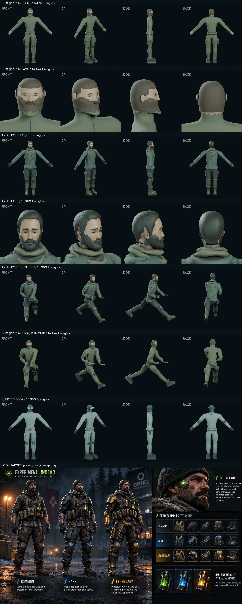
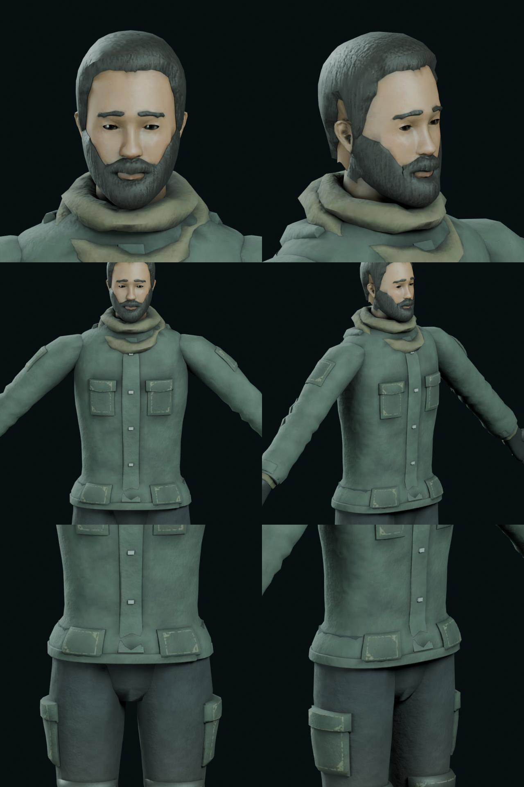
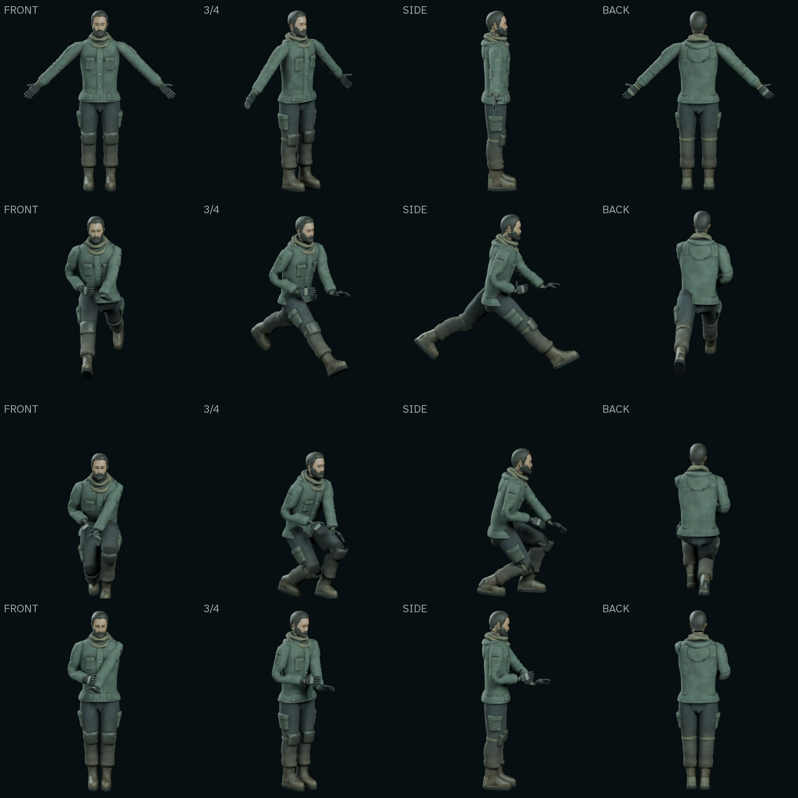

# Player body trial (2026-11-17)

A second take on the survivor body from `docs/plans/player-gear-concept.md`, step 1,
built to compare with the shipped body. It is **not** used by the game: nothing in
`assets/models/` or the real body scripts changed.

Rows, top to bottom: the F-70 step 1 body from PR #314 (read from its branch at 45b669a, not changed),
the trial body, both in the run clip, the body on main, and the concept.

- Source: `tools/assets/body_trial/` (`build.py` builds and checks, `compare.py` renders this sheet).
- Output: `characters/player.glb` in this folder. Same 22 bones, facing, scale and clips as
  the shipped body, 15,960 triangles (budget 16,000), materials BodySkin, BodyHair, BodyCloth, BodyRubber.
- Checks run on it: `check_models.py --dir docs/design/reviews/player-body-trial` and the glTF validator, both pass.

## How it is built

Every part is a "tube": a few key rings (width, front depth, back depth, squareness) along a
straight axis, with a smooth curve through them. Pockets, knee pads and straps are pads that
follow the tube they sit on, so they never float or clip.

## Baked textures (second pass, 2026-11-17)

The person picked "baked textures" as the next step. `textures.py` gives every part its own look
(skin, eyes, hair, jacket, pockets, scarf, trousers, pads, straps, gloves, boots, soles), builds a
detailed material for each in code (cloth grain and wrinkles, hair strands, worn edges, stitching on
pockets, mud towards the ground, lips and eye colour) and bakes them into three 2048 px maps:
colour, normal and roughness. Triangle count is unchanged. The .glb carries the maps (JPEG, 2.8 MB).

## Known weak spots

- Hair reads as a cap and the hair and beard edges are stair-stepped.
- All look colours in `textures.py` are picked by eye from the concept, they are not in look-rules.md yet.
- Texture detail is about 1 mm per pixel, so cloth weave is a grain, not threads.
- The game's gear shader does not read these maps yet (it recolours by zone), so this is a Blender-render result.
- The torso is bulkier than the shipped body, so today's vests would clip (the plan restyles them in step 4).
- Not imported into Godot.

Poses (rest, run, crouch, reload). Clothes follow a named set of bones per part, so the jacket
skirt does not chase the legs and pockets move with the cloth under them.

## Base head (third pass, 2026-11-17)

The carved head is replaced by the head of the MakeHuman base mesh (CC0, see `docs/CREDITS.md`),
kept as `tools/assets/body_trial/base_head.obj`. `head.py` scales it to our height, gives it a
heavier brow and jaw, cuts it down to budget, and grows hair, beard and brows as thin shells cut
along a smooth line, so their edges are no longer stair-stepped. This is the first third-party
asset in a model; the plan was code-built art up to v0.1, so it stays inside this trial.
