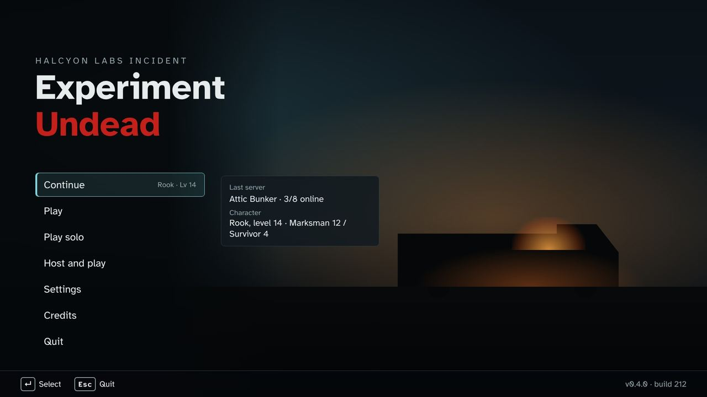
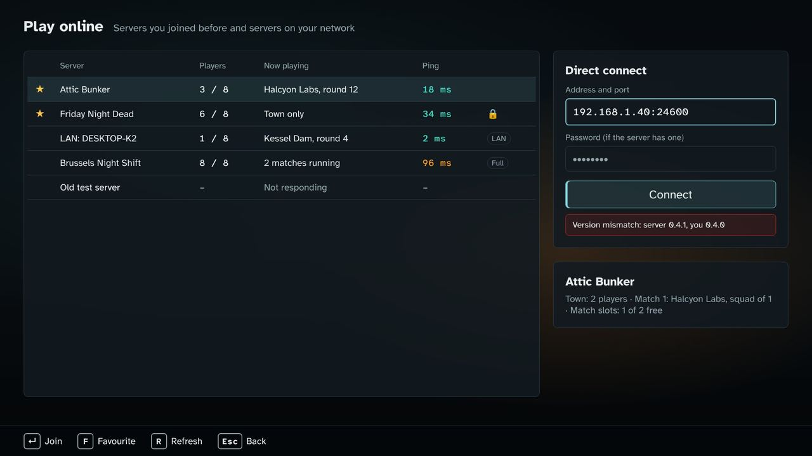
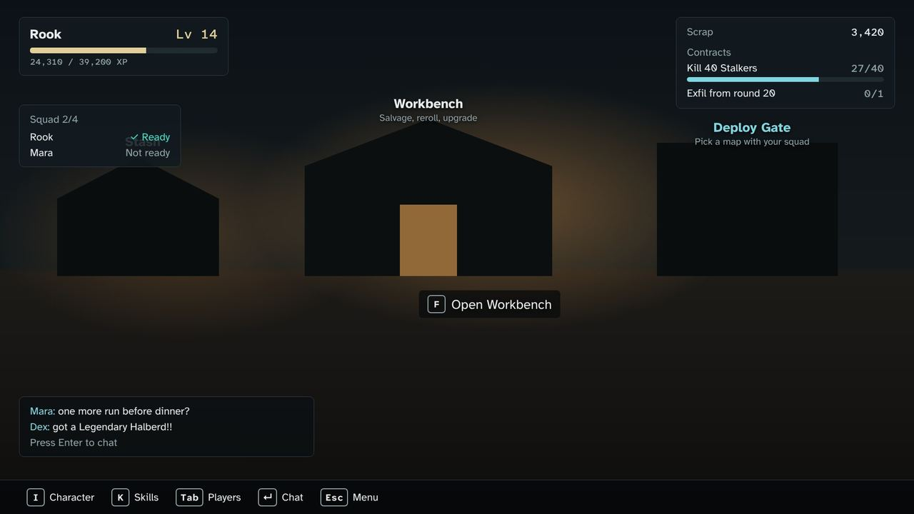
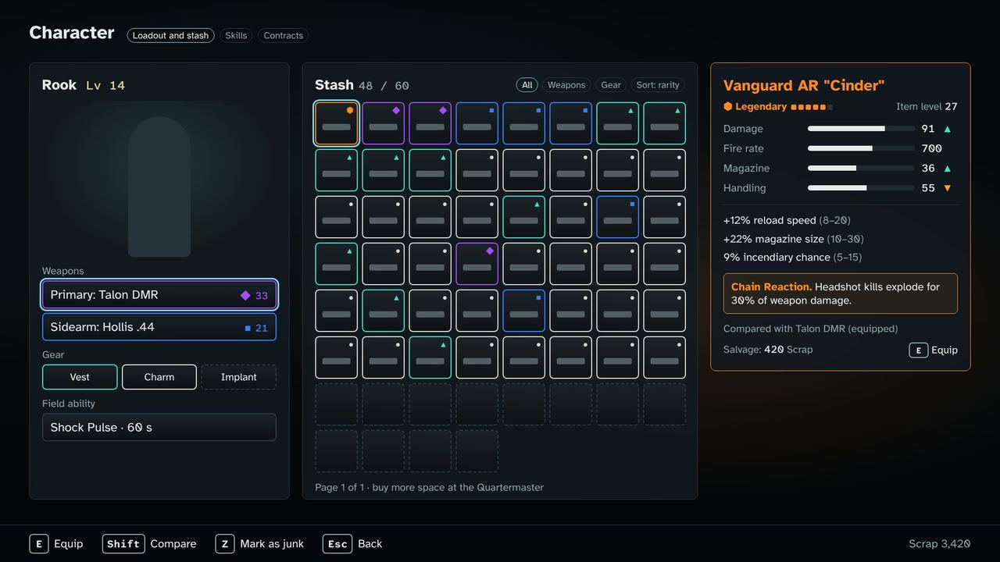
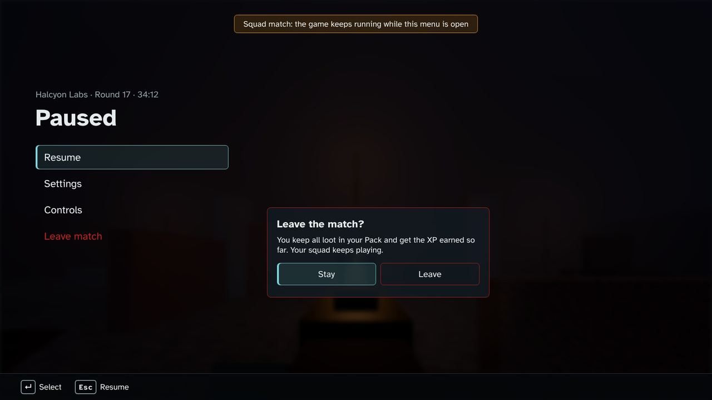
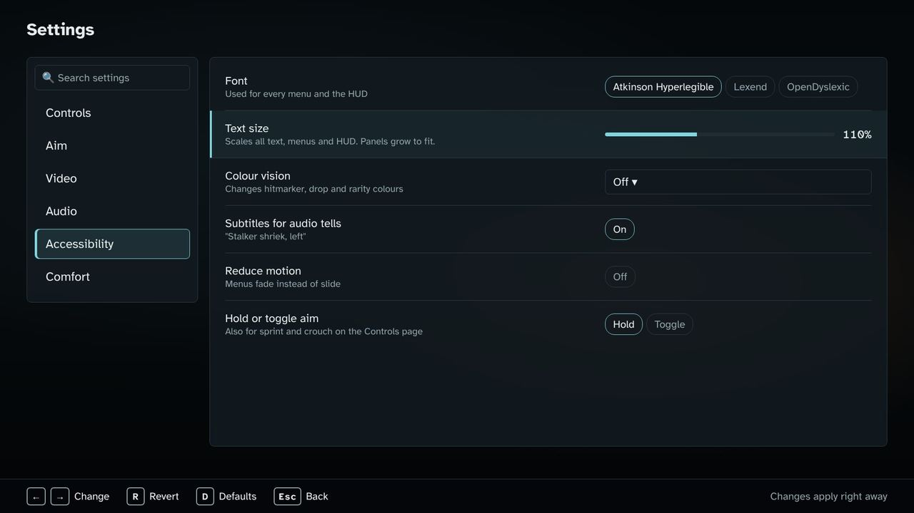

# Menus, HUD and Screen Flow

Source: copy of the design doc (UI/UX spec) as of Nov 14, 2026. Where this file and the code differ, the code and `docs/DECISIONS.md` win.

## Summary

The game has 15 screens in 3 places: the front end (before you join a server), the town (Lantern Post) and the match. Every screen is a Godot scene loaded by one router, styled by one theme, and filled from data files, so a new screen, tab or item type is a data change plus one small scene.

**Rules every screen follows**

1. **Two clicks to play.** From the main menu, Continue puts you in the town with your last character; from the town, the Deploy Gate is the only way into a match.
2. **Easy to read.** Atkinson Hyperlegible by default (Lexend and OpenDyslexic as options), body text never below 24 px at 1080p, left-aligned, no italics, no long all-caps text, short labels. A text size slider scales every screen, not only the HUD.
3. **The middle of the HUD stays empty.** Only the crosshair, hitmarkers and the interaction prompt live in the centre.
4. **Colour always has a second signal.** Rarity has a colour, a shape, a name and pips (Common circle with 1 pip up to Prototype hazard triangle with 6). Low ammo turns orange and shows LOW. This keeps colour-blind players covered.
5. **Keyboard, mouse and controller all work everywhere.** Every screen has a default focus, and the bottom bar shows the right button prompts for the device you last touched.
6. **The town is a place, not a menu.** Stash, Workbench, Trainer and the rest open when you walk up to them and press F. Esc or B always goes back one step.
7. **Nothing blocks a live match.** In a match the pause menu does not pause the game unless you play solo, and inventory is a quick overlay, not a full screen.

## Screen flow

The town is the hub: the front end leads into it, and every match leaves through the Deploy Gate and comes back to it.

_(Diagram not copied: screen flow · 3 areas, 14 screens.)_

Two-way arrows are screens that open on top and close with Esc or B. The first-launch quick setup (shown once, before the main menu) and Settings are not drawn. Settings opens from the main menu, the pause menu and the town Esc menu, and always returns to where you were.

## UI style

Menus look like containment-facility terminals: dark blue-black glass panels, thin teal-grey borders, and one bright accent per screen. Bio-green stays reserved for the experiment (Prototype loot, power-ups, the Vault), so it never appears as a plain button colour.

| Token | Hex | Used for |
| --- | --- | --- |
| bg\_deep | #0B1014 | Full-screen backgrounds, behind panels |
| panel | #121A20 at 88% | Every panel and card |
| panel\_raised | #1A252D | Hovered rows, selected tabs |
| line | #2C3B44 | Borders, dividers |
| text | #E6ECEC | Main text |
| text\_dim | #8FA3A8 | Labels, hints, disabled |
| accent | #7FD6E0 | Focus ring, selected item, primary button (cold fluorescent teal) |
| warn | #FF9F1C | Low ammo, warnings |
| danger | #C3201B | Round number, damage, death, delete |
| headshot | #FFC845 | Headshot hitmarker and kill numbers |
| xp | #E3CF9A | XP bar and level-up (brass) |
| experiment | #8DFF3A | Prototype, power-ups, Vault only |

Rarity colours come from the style guide: Common #D9D9D2, Uncommon #3FE0C8, Rare #3D7DFF, Epic #A64DFF, Legendary #FF8A1C, Prototype #8DFF3A. Each item shows rarity four ways: border colour, rarity shape (circle for Common up to hazard triangle for Prototype), rarity name in the tooltip, and 1 to 6 pips.

**Type.** Atkinson Hyperlegible by default, with Lexend and OpenDyslexic as font options, and Atkinson Hyperlegible Mono for numbers that change (ammo, points, timers) so digits do not jump. Sizes at 1080p: 24 body, 28 headings, 36 screen titles, 56 HUD ammo, 72 round number. All sizes scale with the text size setting (80% to 150%).

**Motion.** Panels fade and slide 12 px in 120 ms. No bounce. Hover is instant. A "reduce motion" setting turns slides into plain fades.

**Sound.** Three UI sounds only: move (soft tick), confirm (relay click) and back (low thunk). Buying and equipping reuse the game's own sounds.

## Screens

Each screen below lists what it shows, what you can do, and where you go next. Mockups are drawn at 1920 x 1080 with the real colours and font sizes.

### 0. First-launch quick setup

Shown once, before the main menu, and again from Settings. One page with big previews: font, text size, subtitles, captions, colour vision preset, and motion comfort. Each choice changes the preview live. **Done** goes to the main menu; **Skip** keeps the defaults.

### 1. Main menu

A slow camera drift over the burning supply truck at the Halcyon Labs dock, with the menu on the left third.

- **Continue** (default focus): joins the last server with the last character. Greyed out on first launch.
- **Play**: opens the server browser.
- **Play solo**: starts a private local server in the background and goes straight to character select. Same code path as online.
- **Host and play**: same as solo, but opens the port so friends can join. Asks for a server name and password once.
- **Settings**, **Credits**, **Quit**.
- Bottom right: game version and build number, for bug reports.



### 2. Server browser and direct connect

There is no master server, so the list holds servers you added or joined before, plus servers found on your local network (LAN broadcast on UDP 24600).

- Columns: name, players (3/8), map in progress, ping, password lock. Sorted by ping.
- **Direct connect** field: address and port, with a password field that appears when the server asks for one.
- Right-click or Y on a row: favourite, rename, remove.
- Errors in plain words: "Server is full (8/8)", "Wrong password", "Version mismatch: server 0.3.1, you 0.3.0".



### 3. Character select and create

Up to 6 character slots, stored in `user://characters/`. Each card shows name, level, the 3 skill branches as small bars, and the loadout primary with its rarity border.

- Create: name, body type, 4 face presets, outfit colour. No class choice: your build comes from skills and loot.
- Delete needs you to type the character's name.
- Import and export a character file, so players can move PCs or back up.


### 4. Town HUD (Lantern Post)

No ammo or round number in town. Top left: level and XP bar. Top right: Scrap and contract tracker (3 lines). Bottom left: chat. Station names float over each building with the key to use them. A squad panel on the left shows your squad (up to 4) with ready ticks. Tab opens the player list with Inspect and Invite.



### 5. Character screen: loadout, stash and inventory

One screen with three columns, opened with I anywhere in town or at the Stash.

- **Left: loadout.** Character model, Sidearm and Primary slots, Vest, Charm and Implant slots, the field ability picked for the next run, and total stats (health, damage bonus, luck).
- **Middle: stash grid.** 60 slots at start (10 x 6), more pages bought with Scrap. Filters: weapons, gear, rarity. Sort: rarity, item level, newest.
- **Right: tooltip.** Shows the hovered item. Hold Shift (or press X on controller) to compare with what you have equipped: better stats in teal with an up arrow, worse in orange with a down arrow.
- Drag and drop, or select and press E to equip. Double-click to send between stash and loadout. Marking items as "junk" (Z) lets the Workbench salvage them all in one go.

**Item tooltip** (one component, used everywhere: stash, pack, ground loot, Vault, inspect):

1. Name in rarity colour, rarity word and pips, item level.
2. Base stats (damage, fire rate, mag, handling) as numbers with small bars.
3. Affixes, one per line, with the rolled value and the possible range in grey ("+12% reload speed (8-20)").
4. Legendary or Prototype trait in its own box.
5. Salvage value in Scrap, and button hints.



### 6. Skill tree (Trainer)

Three columns side by side: Marksman, Survivor, Tinkerer. Nodes run top to bottom, with the keystone at 15 points and capstone at 25 drawn larger. A node shows ranks (2/3). Points spent per branch sit above each column. Points left and respec count (Free respecs: 2 of 3) at the top.

- Click or A to add a rank, right-click or B to remove before you confirm. Nothing is saved until **Confirm**.
- The field ability picker sits below the tree: 5 slots, locked ones show the unlock level.
- Open with K anywhere in town. Respec only works at the Trainer.


### 7. Workbench, Quartermaster, Contract Board, Hall of Records

These reuse the stash grid and tooltip with one action panel on the right:

- **Workbench:** Salvage (selected or all junk), Reroll affix (pick the line, see the cost), Raise item level (+5).
- **Quartermaster:** a shop grid with Scrap prices, the daily Rare offer pinned at the top.
- **Contract Board:** 3 daily and 3 weekly cards with progress bars and rewards. Pin up to 3 to the town and match HUD.
- **Hall of Records:** a table per map, weekly and all-time, best round, squad names.

### 8. Deploy Gate (map select and squad)

Walking into the Deploy Gate opens this. Left: map cards (picture, name, your best round, locked or not). Right: the squad (up to 4) with each player's level, primary and ready state, plus mode: **Squad**, **Solo**, or **Join public match** if one is filling.

- The squad leader picks the map. Everyone presses Ready. A 5-second countdown starts, any player can cancel it.
- Shows the server's match slots: "Matches running: 1 of 2". If both are busy: "Wait for a slot, about 8 min".


### 9. Loading

Map art, the map name, and one rotating tip. A progress bar, and the names of squad members as they finish loading. Never longer than needed: no "press any key".

### 10. Match HUD

Follows the design doc table. Additions:

- **Top right:** squad cards (name, health bar, down state with bleed-out timer) and pinned contracts.
- **Bottom left, above serums:** field ability icon with a cooldown ring, and the Pack count (4/6).
- **Bottom centre:** power-up timers, and a small item drop feed ("Rare Talon DMR" in rarity colour) that fades after 4 s.
- **Health:** no health bar for yourself, like the design doc: red vignette under 40 HP and a short heartbeat. A thin bar only appears when Ironhide or gear raises max health above 150, so the extra health is readable.
- **Exfil:** from round 10, every 5 rounds, a marker and a 60 s hold bar appear at the top centre.


### 11. Pack overlay

Tab in a match. A half-screen panel over the HUD with the 6 Pack slots, your 2 equipped guns and the tooltip. The game keeps running behind it (it is a quick check, not a menu). You can drop items or swap a Pack gun into your hands. Mouse look is paused while it is open; movement keys still work.


### 12. Pause

Esc. Resume, Settings, Controls, Leave match (asks to confirm and says "You keep all loot"). In solo the game pauses; in a squad it does not, and a banner says so.



### 13. Death and run results

When you die (or the whole squad goes down), the camera drifts up for 3 s, then the results screen:

- **Top:** "Round 17 reached" in red numeral, map, time.
- **Left column:** kills, headshots, points earned, Vault rolls, best weapon.
- **Middle:** loot kept, shown as item cards in rarity colours, the best one first and larger. Every item from the Pack goes to your stash automatically.
- **Right:** XP gained as a filling brass bar with level-ups called out, skill points earned, Scrap earned, contract progress.
- Buttons: **Back to town** (default), **View squad** (each player's stats).

Exfil uses the same screen with a green "Exfiltrated" banner and the exfil cache items.


### 14. Settings

Pages: Controls, Aim, Video, Audio, Accessibility, Comfort, with a search box at the top that finds any setting by name. Each row is a label, a control, and a one-line hint under it. The full list of rows lives in the [Controls and accessibility plan](controls.md); this doc only covers the layout. Changes apply live, with "Revert" and "Defaults" at the bottom. Video changes that need a restart say so.

- **Accessibility tab:** text size, colour-blind mode (3 presets for hitmarkers, drops and rarity), subtitles for audio tells, screen shake, reduce motion, hold or toggle for ADS, sprint and crouch, aim assist for controller.
- **Controls tab:** every action from the input map, with keyboard and controller columns and a "press a key" rebind.



## Godot structure

One autoload (`UI`) owns a stack of screens, one theme styles everything, and screens read their lists, tabs and items from Resources. Adding a town station or a settings row is a new `.tres` file, not new layout code.

**Folders** (fits the architecture doc):

```
core/ui/ui.gd                 autoload: screen stack, overlays, toasts, input prompts
systems/ui/theme/             main_theme.tres, ui_tokens.tres, fonts/
systems/ui/widgets/           item_card, item_tooltip, stat_row, rarity_pips, key_prompt,
                              cooldown_ring, tab_bar, confirm_dialog, list_row
systems/ui/screens/<name>/    one folder per screen: <name>.tscn + <name>.gd
systems/ui/hud/               hud.tscn + one scene per element (round, ammo, points, ...)
content/ui/screens/           ScreenData .tres (id, scene, layer, pauses_game, music)
content/ui/hud_layouts/       HudLayout .tres (which elements, anchor, offset, scale)
content/ui/settings/          SettingData .tres (one per settings row)
content/ui/tips/              loading tips
```

**Screen router.** `UI.push(&"stash")`, `UI.pop()`, `UI.replace(&"town_hud")`. The router looks up `content/ui/screens/stash.tres`, instances its scene on the right layer, gives it focus and plays the transition. Back (Esc, B) always calls `pop()`. Screens never load other screens directly, so the flow lives in one place and tests can push any screen on its own.

**Layers** (one CanvasLayer each, low to high): world labels 0, HUD 10, screens 20, overlays (pack, pause) 30, modals (confirm, rebind) 40, toasts and loading 50.

**Theme.** One `main_theme.tres` with type variations (`PanelRaised`, `ButtonPrimary`, `LabelDim`, `LabelMono`) so scenes never set colours by hand. `ui_tokens.tres` holds the colour table above plus rarity colours, and both the theme and shaders read from it, so a colour-blind preset swaps one resource. Font sizes are set at 1080p. The `UI` autoload multiplies every theme font size by the text size setting at startup and when the setting changes; layout uses containers, so panels grow with the text instead of clipping it.

**Data-driven content.**

- **Items:** `item_card` and `item_tooltip` take an item dictionary (the architecture doc rule: items as dicts) and read names, stats and affix ranges from `WeaponData`, `GearData` and `AffixData`. A new weapon or affix shows up in every screen with no UI work.
- **Stations:** each town station is a `StationData` .tres: id, display name, prompt text, and which screen plus which action panel it opens. Adding a station = one .tres and, if it needs one, an action panel scene.
- **Skill tree:** drawn from `SkillNodeData` (branch, row, column, max ranks, requires). The tree screen builds itself from the files, so moving a node is a data edit.
- **Settings:** each `SettingData` names its tab, label, hint, control type (toggle, slider, dropdown, keybind), range and the `Settings` autoload key. The settings screen is generated from these files.
- **HUD:** `hud.tscn` reads a `HudLayout` and places each element by anchor and offset. A "HUD editor" later only needs to write that resource.

**Signals and data flow.** Screens never change game state themselves. They call requests (`Economy.try_spend`, `ProgressionService.equip`) and listen to `Events` (`item_equipped`, `points_changed`, `round_started`). In multiplayer the server stays the authority and the UI just reflects what it hears, so the same screens work solo and online.

**Input.** Every screen sets `default_focus`. A `key_prompt` widget reads the input map and shows the right glyph (keyboard or controller) for the last device used. Mouse capture is handled only by the router: it frees the mouse when any screen above the HUD is open.

**Tests.** A GUT test pushes every `ScreenData` once and checks it loads, has a default focus, and that `pop()` returns to the screen below. A validator test checks every `SettingData` key exists in `Settings` and every `StationData` points at a real screen.

## Build order

UI is built in the same phases as the roadmap, so no screen is made before the system behind it exists.

| Phase | UI work |
| --- | --- |
| P0 Foundation | `UI` router, layers, theme and tokens, fonts, `key_prompt`, Settings screen (generated from `SettingData`), Pause |
| P1 Gun feel | Crosshair, hitmarkers, ammo, damage arcs, vignette |
| P2 Wave loop | Round number, points with floating numbers, interaction prompt, power-up timers, serum row, simple results screen |
| P4 Map 1 (v0.1) | Main menu, Loading, final HUD polish, results screen in final look |
| P5 Levels and skills | XP bar, level-up toast, Skill tree, field ability icon |
| P6 Loot (v0.2) | Item card and tooltip, Pack overlay, drop feed, Character screen (loadout, stash), results loot column, character select |
| P7 Co-op | Squad cards, down and revive states, results View squad |
| P8 Server package | Server browser, direct connect, Host and play |
| P9 Town hub (v1.0) | Town HUD, stations (Workbench, Quartermaster, Contracts, Records), Deploy Gate, player list and inspect, chat |

**Provisional decisions (taken without a review, change any of them)**

- **Main menu background: a live 3D scene** of the Halcyon Labs dock, reusing Map 1 with a slow camera drift. A pre-rendered video is the fallback if loading takes too long.
- **Pack overlay: the game keeps running at full speed**, solo too. Only mouse look pauses. This keeps it a quick check, not a safe spot.
- **Controller: supported at launch**, following the controller layouts in the [Controls and accessibility plan](controls.md). Every screen gets a default focus and button glyphs from P0, so this costs little up front.
